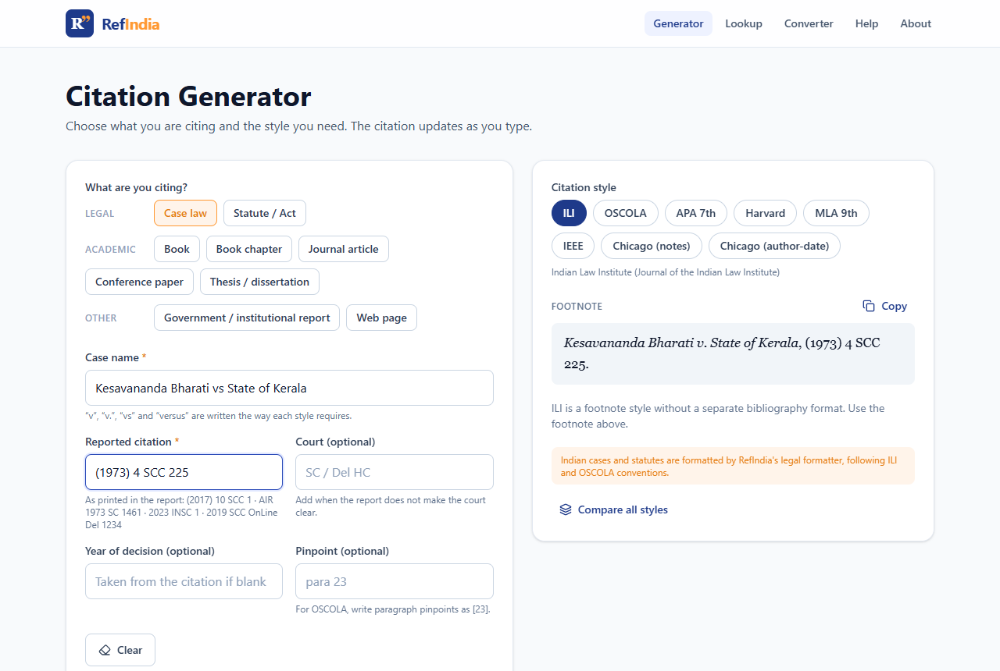
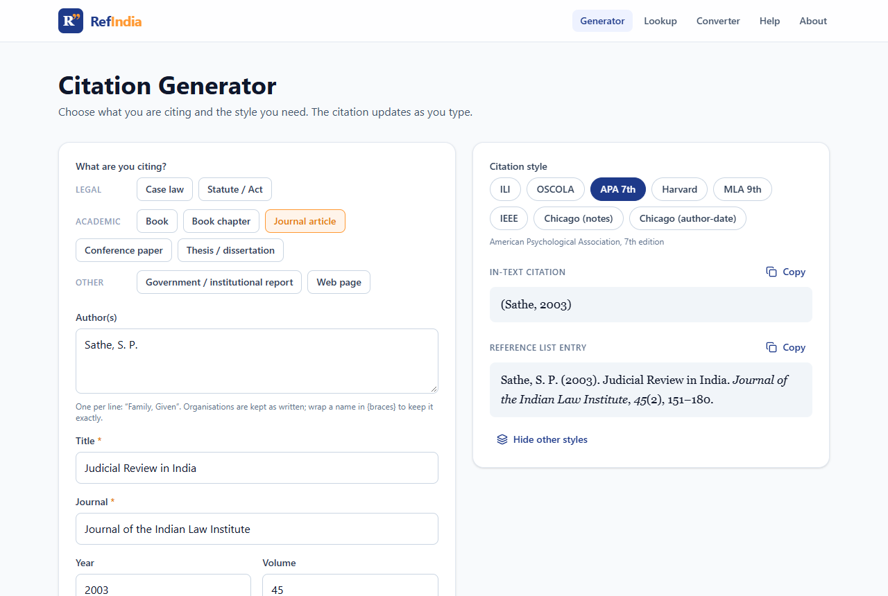
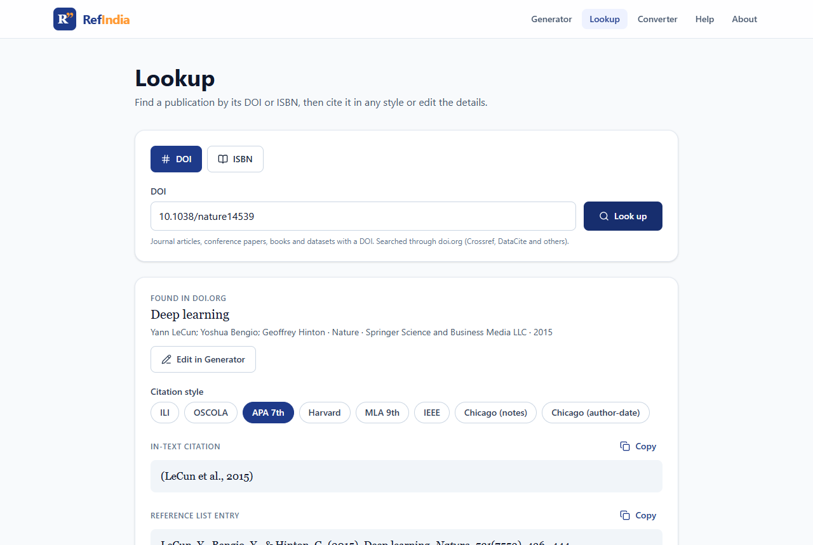
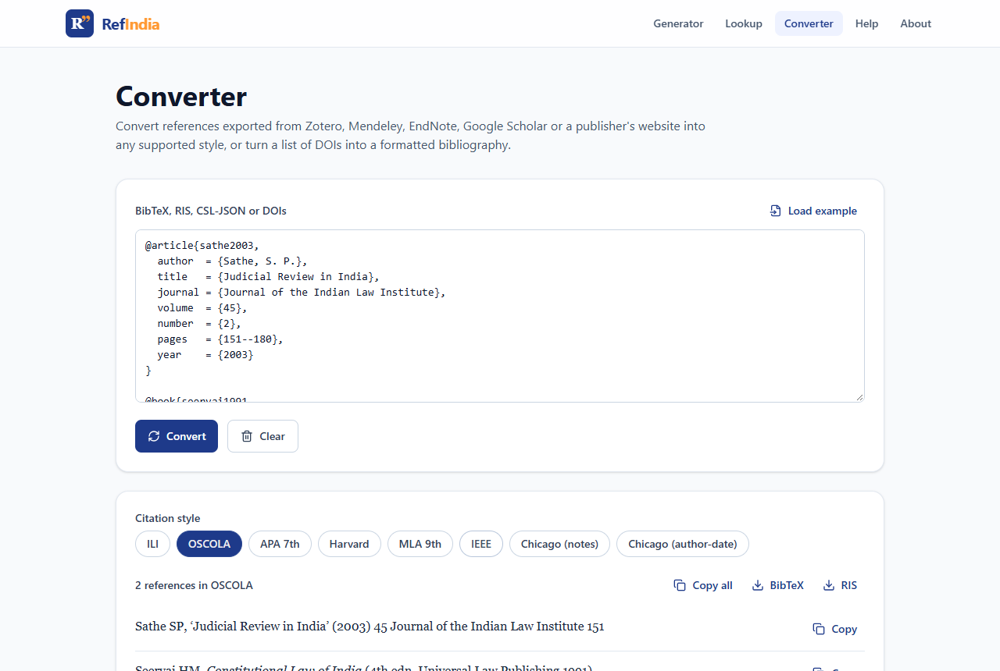

# RefIndia

**Citations for Indian law and academia.** Cite Supreme Court and High Court judgments, Acts, books, journal articles, theses and reports in **ILI, OSCOLA, APA, Harvard, MLA, IEEE and Chicago**: free, open source, and entirely in your browser.

**[Open RefIndia →](https://ratiojuris.github.io/RefIndia/)**

<picture>
  <source media="(prefers-color-scheme: dark)" srcset="docs/screenshots/home-dark.png">
  
</picture>

## Why RefIndia

General citation tools handle books and journal articles well, but not Indian law reports or Indian Acts. RefIndia does both.

| You enter | ILI | OSCOLA |
|---|---|---|
| Kesavananda Bharati vs State of Kerala, (1973) 4 SCC 225 | *Kesavananda Bharati v. State of Kerala*, (1973) 4 SCC 225. | *Kesavananda Bharati v State of Kerala* (1973) 4 SCC 225. |
| Information Technology Act, 2000 · Act 21 of 2000 · s 43 | The Information Technology Act, 2000 (Act 21 of 2000), s. 43. | The Information Technology Act, 2000, s 43. |

## Features

- **Generator:** cases, statutes, books, chapters, journal articles, conference papers, theses, government reports and web pages. The form adapts to the source type, and the citation updates as you type.
- **Indian legal formatter:** SCC, AIR, INSC neutral citations, SCC OnLine and SCR; “vs”, “v.” and “versus” are normalised to each style's form; pinpoints and courts are supported.
- **Eight styles:** ILI, OSCOLA, APA 7th, Harvard (Cite Them Right), MLA 9th, IEEE, Chicago notes and Chicago author-date, using the official [Citation Style Language](https://citationstyles.org/) styles.
- **Footnote and bibliography forms,** labelled correctly for each style (footnote, in-text citation, reference list, works cited).
- **Compare all styles** side by side.
- **Lookup:** real metadata by DOI (doi.org, Crossref, DataCite) or ISBN (Open Library, then Google Books), with “Edit in Generator”.
- **Converter:** BibTeX, RIS, CSL-JSON or a list of DOIs into a formatted, correctly numbered bibliography; export as BibTeX or RIS.
- **Copy with formatting:** italics are kept when you paste into Word or Google Docs.
- **Private:** no account, no server, no cookies, no analytics. Light and dark themes.

<table>
<tr>
<td width="50%">
<picture>
  <source media="(prefers-color-scheme: dark)" srcset="docs/screenshots/generator-case-dark.png">
  
</picture>
<p align="center"><sub>Citing a Supreme Court judgment in ILI</sub></p>
</td>
<td width="50%">
<picture>
  <source media="(prefers-color-scheme: dark)" srcset="docs/screenshots/generator-article-dark.png">
  
</picture>
<p align="center"><sub>A journal article in APA 7th</sub></p>
</td>
</tr>
<tr>
<td width="50%">
<picture>
  <source media="(prefers-color-scheme: dark)" srcset="docs/screenshots/lookup-dark.png">
  
</picture>
<p align="center"><sub>Lookup by DOI</sub></p>
</td>
<td width="50%">
<picture>
  <source media="(prefers-color-scheme: dark)" srcset="docs/screenshots/converter-dark.png">
  
</picture>
<p align="center"><sub>BibTeX converted to OSCOLA</sub></p>
</td>
</tr>
</table>

## What RefIndia does not do

- **Free-text conversion.** Citations copied from a document are ambiguous and cannot be converted reliably, so the Converter accepts structured input (BibTeX, RIS, CSL-JSON, DOIs) instead of guessing.
- **Web page metadata lookup.** A browser-only app cannot read other websites. Enter web page details by hand.
- **Guarantee compliance.** Universities, journals and courts often have their own rules. Always check the final citation.

## Development

Requires Node.js 24 or later.

```bash
npm install
npm run dev       # http://localhost:5173/RefIndia/
npm test          # Indian legal formatter tests
npm run build     # type-check and build to dist/
```

Every push to `main` is tested, built and deployed to GitHub Pages by [`.github/workflows/deploy.yml`](.github/workflows/deploy.yml).

### Project structure

```
src/
  lib/
    legal.ts      Indian case and statute formatter (ILI, OSCOLA and others)
    engine.ts     citation.js setup, CSL formatting, BibTeX/RIS import and export
    sources.ts    source types, form fields and CSL-JSON mapping
    styles.ts     the eight styles and how each labels its output
    lookup.ts     DOI and ISBN lookups
  csl/            official CSL style files (see NOTICE.md)
  pages/          Home, Generator, Lookup, Converter, Help, About
tests/            node:test tests for the legal formatter
```

### Adding a style

1. Download the `.csl` file from the [CSL styles repository](https://github.com/citation-style-language/styles) into `src/csl/`.
2. Import it in `src/lib/engine.ts` and add an entry to `STYLES` in `src/lib/styles.ts`.

## Privacy, terms and support

RefIndia's [Privacy Policy](https://ratiojuris.github.io/legal/refindia/privacy/), [Terms of Use](https://ratiojuris.github.io/legal/refindia/terms/) and [Support](https://ratiojuris.github.io/legal/refindia/support/) are in the RatioJuris Legal Centre.

## Licence

RefIndia is released under the [MIT licence](LICENSE). The CSL style files are licensed under CC BY-SA 3.0; see [`src/csl/NOTICE.md`](src/csl/NOTICE.md).
